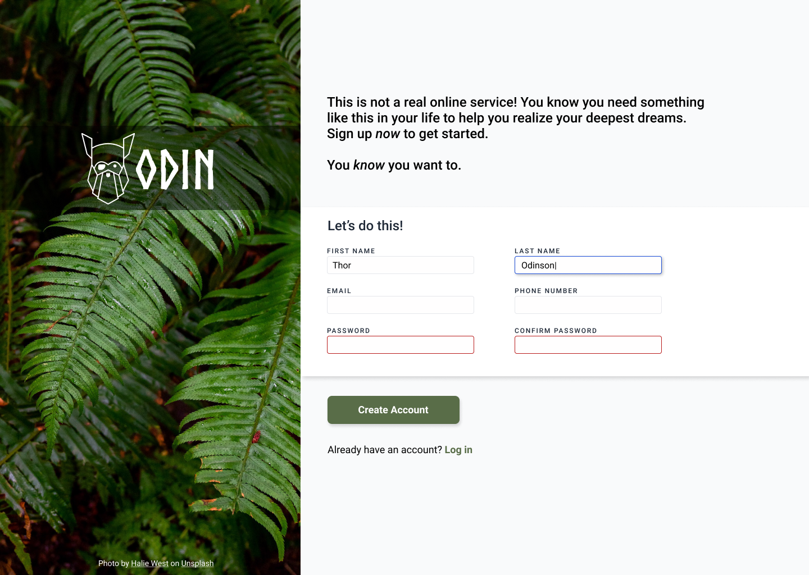

# The Odin Project: Sign-up Form

A split-screen dummy Sign-up Form built as part of [The Odin Project's Intermediate HTML and CSS Course](https://www.theodinproject.com/lessons/node-path-intermediate-html-and-css-sign-up-form). The primary focus of this project is structural layout organization, form control alignment, and using pure CSS interactive states for user validation.

## 🚀 Live Demo
👉 **[View Live Demo Here](https://rudyravelindev.github.io/sign-up-form/)**


## 🎨 Design Provided


---

## 🛠️ Features & Project Requirements

### Layout & Page Scaffolding
* **Split-Screen Design:** A prominent left-hand image sidebar balanced against a comprehensive text and user action dashboard on the right.
* **Text Readability Mask:** A semi-transparent overlay positioned directly behind the primary brand typography to provide strict color contrast against a busy background graphic.
* **Palette Matching:** Core interaction nodes (like the primary "Create Account" button) use custom color styling (`#596D48`) synchronized with tones from the sidebar image.

### CSS Form Validation States
* **Default States:** Form inputs default to standard structural guidelines with a very light border configuration (`#E5E7EB`).
* **Active Input Focus:** Selected elements dynamically display a bright blue border coupled with a subtle depth box-shadow using the `:focus` pseudo-class.
* **Individual Error Boundary Rules:** Invalid inputs switch immediately to sharp red borders using the native CSS `:user-invalid` pseudo-class configuration to capture error trends independently before processing data.

---

## 💻 Tech Stack
* **HTML5:** Semantic form inputs, group containers, and linked asset structures.
* **CSS3:** Flexbox/Grid layout scaffolding, background configuration tools, custom color overlays (`rgba()`), and pseudo-class state rules (`:focus`, `:user-invalid`).

---

## 🔧 Setup & Local Installation

To open and inspect this project locally on your machine, clone the repository using your preferred development terminal environment:

```bash
# Clone this repository
git clone https://github.com/rudyravelindev/sign-up-form

# Navigate into the project folder
cd sign-up-form
```

Launch the project by executing your local text editor server extensions (e.g., Live Server for VS Code) or by directly opening the `index.html` file inside any standard desktop web browser engine.

---

## ⚖️ Credits & Asset Attribution
* **Sidebar Background Art:** <a href="https://unsplash.com/fr/@shanerounce?utm_source=unsplash&utm_medium=referral&utm_content=creditCopyText" target="_blank" rel="noopener">Shane Rounce</a> on <a href="https://unsplash.com/fr/photos/un-groupe-de-personnes-se-tenant-la-main-au-sommet-dun-arbre-DNkoNXQti3c?utm_source=unsplash&utm_medium=referral&utm_content=creditCopyText" target="_blank" rel="noopener">Unsplash</a>


